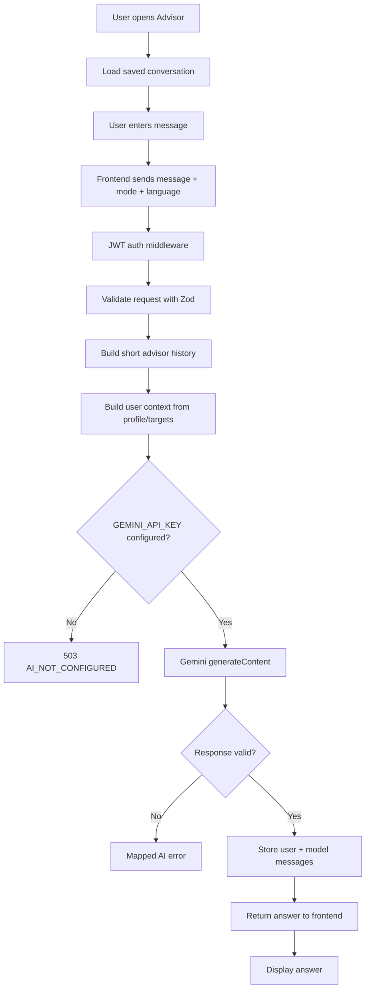
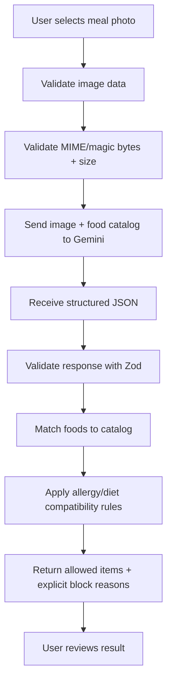

# AI Nutrition Advisor Workflow

## AI chat workflow

## Photo-analysis workflow

## Safety boundary

The AI is an assistant, not a medical diagnostic system. The system prompt instructs the model to provide general guidance, avoid diagnosis/treatment, respect allergies and dietary restrictions, treat calorie values as estimates, and recommend professional care for pregnancy, medical conditions, eating disorders or children.

The server-side eligibility rules remain authoritative for food compatibility. The AI does not get permission to override allergy or diet restrictions.

## Configuration

- `GEMINI_API_KEY`: server-only secret; empty during development is supported.
- `GEMINI_MODEL`: defaults to `gemini-2.5-flash`.
- Chat timeout: 30 seconds.
- Photo-analysis timeout: 45 seconds.
- AI request rate limit: 20 requests/minute per process.
