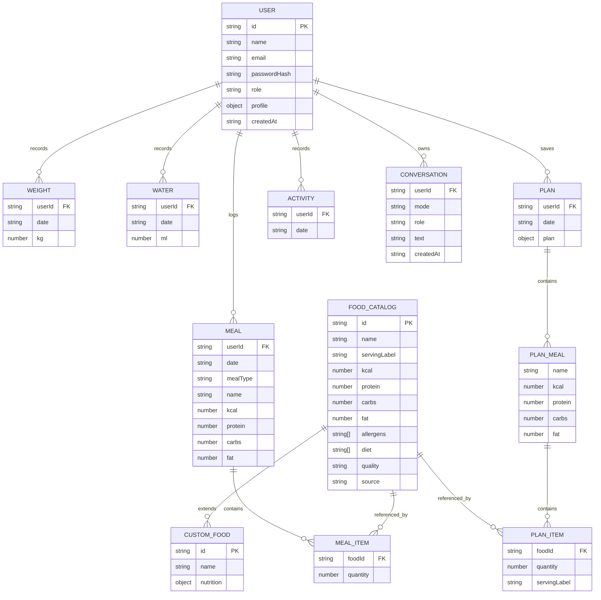

# NutriCare Data / ER Diagram

NutriCare currently uses a small JSON-file persistence layer rather than a relational database. The diagram below represents the logical data relationships used by the application.

## Persistence note

The implementation uses `server/db.ts` with a JSON file store. Missing collections are restored during loading so older database files can migrate forward without dropping existing data.
