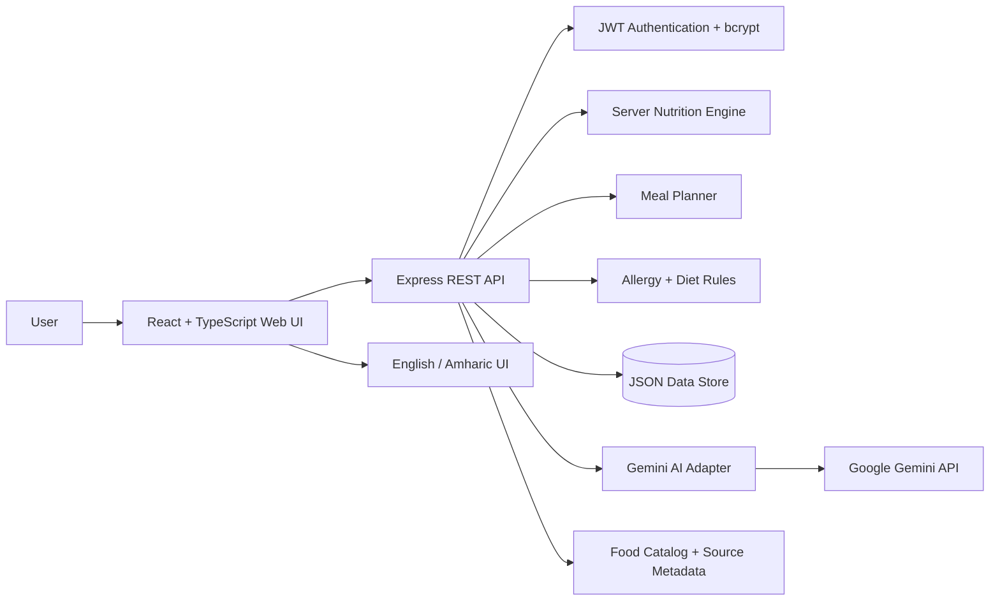

# NutriCare System Architecture

## Overview

NutriCare is a web-based AI nutrition advisor built with a React + TypeScript frontend and an Express + TypeScript backend. The backend owns authentication, nutrition calculations, food eligibility rules, meal-plan generation, persistence, and the Gemini AI integration.

## Main components

| Component | Responsibility |
|---|---|
| React UI | Pages, forms, advisor chat, scanner, diary, plans, profile and navigation |
| API client | Sends authenticated requests to `/api/*` endpoints |
| Express API | REST endpoints, validation, authorization and application orchestration |
| JWT auth | 30-day signed sessions using HS256 and a server-side secret |
| bcrypt | Password hashing with cost factor 12 |
| Nutrition engine | BMI, Mifflin-St Jeor, calorie targets and nutrition calculations |
| Food catalog | Ethiopian and common foods with nutrition, allergens, diet compatibility and source metadata |
| Meal planner | Deterministic calorie/macro scoring plus allergy/diet filtering and variety rotation |
| JSON store | Users, meals, plans, progress records, custom foods and AI conversations |
| Gemini adapter | AI chat and food-photo analysis, with timeout/error mapping |

## Deployment boundary

The browser should communicate with the backend through the same origin in a production deployment. If a separate frontend origin is required, `CORS_ORIGIN` must explicitly list trusted origins.
